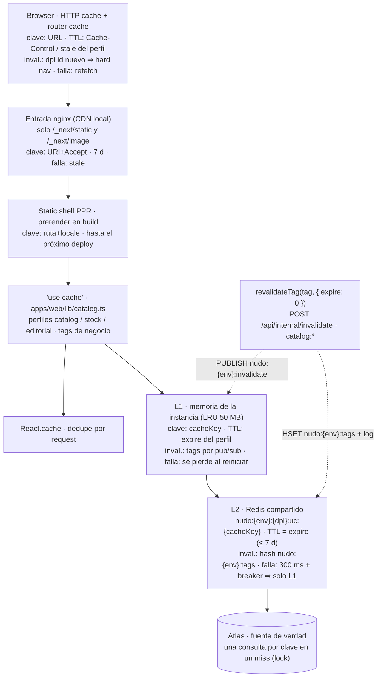

# Caché: capas, claves, TTL, invalidación y fallas (R20, §5.2)

Decisiones en ADR 006 (multinivel + pub/sub), ADR 007 (entrada de tráfico), ADR 008 (imágenes) y ADR 017 (invalidación interna).

## Diagrama (§5.2 completo)

## Capas

| Capa               | Qué guarda                                             | Clave                                                    | TTL / perfil                                               | Invalidación                                                                    | Si se cae                                                                         |
| ------------------ | ------------------------------------------------------ | -------------------------------------------------------- | ---------------------------------------------------------- | ------------------------------------------------------------------------------- | --------------------------------------------------------------------------------- |
| Browser            | HTML/RSC, JSON público, assets                         | URL (+ `?dpl=` en assets)                                | `Cache-Control` (abajo); router cache = `stale` del perfil | Deploy nuevo ⇒ `x-nextjs-deployment-id` distinto ⇒ hard navigation              | —                                                                                 |
| nginx (CDN local)  | `/_next/static`, `/_next/image`                        | URI (+ `Accept` en imágenes)                             | 7 días                                                     | URL nueva (hash / variante); purga del volumen                                  | `proxy_cache_use_stale`; sin nginx no hay entrada (en prod lo reemplaza la CDN)   |
| Static shell PPR   | Shell de cada ruta y locale                            | ruta + locale                                            | hasta el siguiente build                                   | Nuevo deploy                                                                    | Se sirve desde disco de la instancia                                              |
| `React.cache`      | Resultado de cada lectura dentro de un request         | argumentos                                               | el request                                                 | —                                                                               | —                                                                                 |
| `'use cache'` L1   | Resultado serializado (bytes) de cada función cacheada | `cacheKey` de Next (incluye `deploymentId` y argumentos) | `expire` del perfil, LRU 50 MB                             | Timestamps por tag (propios + soft) recibidos por pub/sub o leídos del hash     | Se reconstruye desde L2                                                           |
| `'use cache'` L2   | Lo mismo, compartido                                   | `nudo:{env}:{deploymentId}:uc:{cacheKey}`                | `EX = expire` (≤ 7 días)                                   | Hash `nudo:{env}:tags`; la entrada vieja queda pero se ignora (timestamp < tag) | Timeout 300 ms + breaker: solo L1, cada instancia regenera; nunca rompe el render |
| Lock anti-stampede | Token de quien regenera una clave                      | `nudo:{env}:{deploymentId}:uc-lock:{cacheKey}`           | 10 s (`PX`)                                                | Se libera al guardar (Lua compara token)                                        | Sin Redis no hay coordinación: regenera cada instancia (degradado)                |
| Atlas              | Catálogo, inventario, pedidos                          | —                                                        | —                                                          | Mutaciones `catalog:*`                                                          | Miss sin datos ⇒ error de la página (no se cachean errores)                       |

## Perfiles `cacheLife` (`apps/web/next.config.ts`)

| Perfil      | stale  | revalidate | expire | Uso                                                                         |
| ----------- | ------ | ---------- | ------ | --------------------------------------------------------------------------- |
| `catalog`   | 5 min  | 15 min     | 1 día  | Ficha, galería, precio de lista, categorías. Cambia por operación (tag).    |
| `stock`     | 30 s   | 30 s       | 5 min  | Disponible por SKU. El checkout siempre revalida contra Mongo al confirmar. |
| `editorial` | 15 min | 1 h        | 7 días | Home, banners, campañas.                                                    |

## Tags (`packages/data/src/cache/tags.ts`)

| Tag             | Cubre                                                          | Lo invalida                                 |
| --------------- | -------------------------------------------------------------- | ------------------------------------------- |
| `product:{id}`  | Ficha completa (nombre, descripción, galería, precio, slug)    | precio, nombre, estado, slug                |
| `category:{id}` | PLP / navegación de la categoría (tarjetas del producto)       | lo mismo que `product`, para sus categorías |
| `stock:{sku}`   | Disponibilidad de un SKU                                       | stock (solo esto: ni ficha ni galería)      |
| `locale:{l}`    | Todo lo renderizado para un idioma                             | cambios de diccionario / contenido          |
| `catalog`       | Índice global: sitemap, llms.txt, búsqueda, slugs inexistentes | estado, slug                                |
| `editorial`     | Contenido editorial                                            | publicación de campaña                      |

Los tags no llevan prefijo de entorno: el aislamiento está en las claves de Redis (`nudo:{env}:…`). El endpoint interno rechaza cualquier tag fuera de esta tabla.

## Qué no entra nunca en una caché compartida

Carrito, sesión de checkout, datos de contacto y pedidos: viven en Redis bajo `nudo:cart:*` / `nudo:checkout:*` (ADR 005) y se leen en el request, nunca dentro de `'use cache'`. `apps/web/lib/catalog.ts` solo recibe ids/slugs/SKUs públicos.

## `Cache-Control`

| Recurso                          | Header                                                                       |
| -------------------------------- | ---------------------------------------------------------------------------- |
| `/_next/static/*`                | lo pone Next: `public, max-age=31536000, immutable`                          |
| `/catalog/*` (imágenes fuente)   | `public, max-age=86400, stale-while-revalidate=604800`                       |
| `GET /api/products/{id}`         | `public, max-age=0, s-maxage=30, stale-while-revalidate=30` (perfil `stock`) |
| `/api/internal/*`, `/api/health` | `no-store`                                                                   |
| Páginas                          | las define Next según PPR / perfil (Fase 3 las verifica por ruta)            |

## Cómo demostrarlo (R05)

- `Server-Timing` en `GET /api/products/{id}`: `catalog;dur=…`, `redis;dur=…`, `cache;desc="hit (hit=2 miss=0 stale=0)"`, `total;dur=…`. Segunda visita ⇒ `hit`; después de `pnpm catalog:invalidate product:{id}` ⇒ `miss`.
- `GET /api/internal/invalidate` (con secreto): últimas invalidaciones `{ tag, kind, at, instance }`.
- Logs JSON por request: `instance`, `requestId`, `route`, `locale`; eventos del handler `cache.regenerate` / `cache.wait-timeout`.
- Stampede: `tests/api/r20-r05-cache.spec.ts` (100 requests, 1 instancia) y `tests/multi/r04-multi-instance.spec.ts` (150 requests, 3 instancias) ⇒ una consulta a Atlas por clave.
