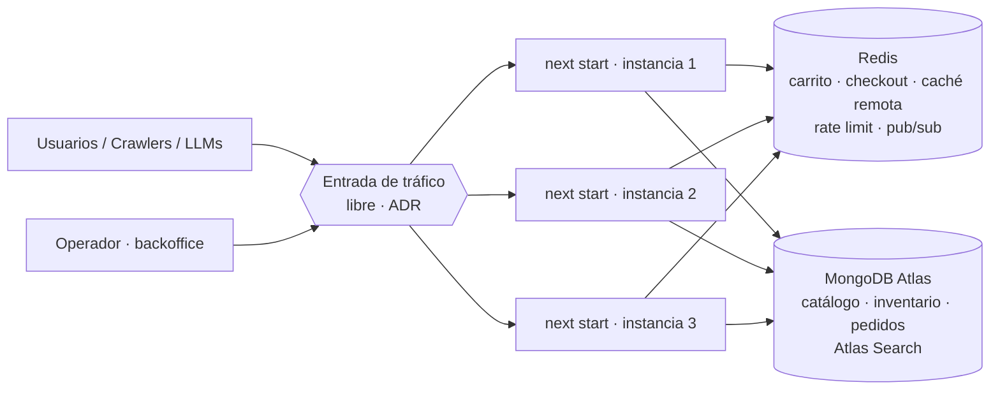
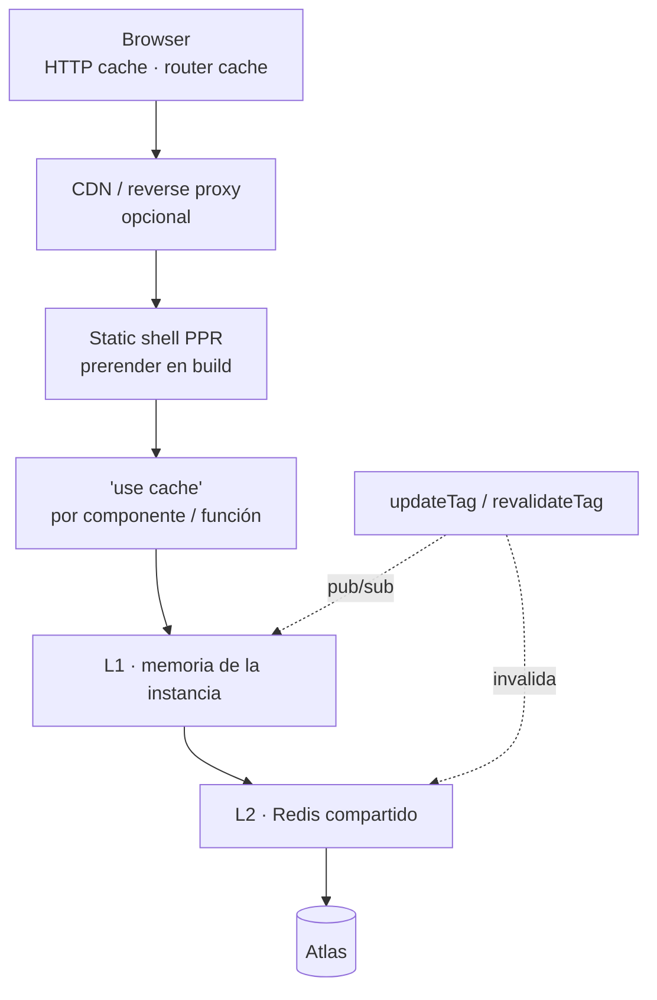
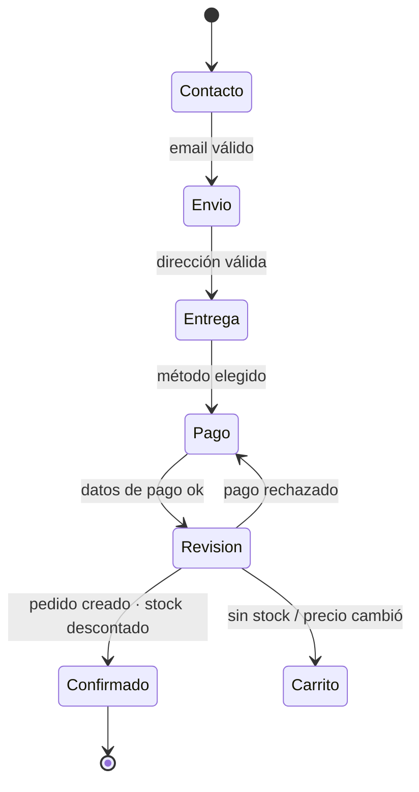

# Lab Avanzado de Next.js — Mini Commerce **NUDO**

> **Tipo:** consigna (letra del problema). No incluye la solución.
> **Nivel:** avanzado · **Duración sugerida:** 6–8 semanas · **Modalidad:** individual (o dupla, declarando quién hizo qué)
> **Base teórica:** Next.js Learn — [App Router](https://nextjs.org/learn/dashboard-app) (caps. 1–15) y [SEO](https://nextjs.org/learn/seo) (curso completo)
> **Stack fijo:** Next.js 16.3.x (App Router, `cacheComponents`) · React 19.2+ · TypeScript `strict` · MongoDB Atlas · Redis · SCSS Modules

---

## Índice

0. [TL;DR](#0-tldr)
1. [Objetivos de aprendizaje](#1-objetivos-de-aprendizaje)
2. [Mapa de los cursos](#2-mapa-de-los-cursos)
3. [Reglas del juego](#3-reglas-del-juego)
4. [Letra del sistema](#4-letra-del-sistema)
5. [Arquitectura objetivo](#5-arquitectura-objetivo)
6. [Modelo de datos](#6-modelo-de-datos)
7. [Requerimientos](#7-requerimientos)
8. [Entregables](#8-entregables)
9. [Presentación final](#9-presentación-final)
10. [Metaaprendizaje](#10-metaaprendizaje)
11. [Checklist de autoevaluación](#11-checklist-de-autoevaluación)
12. [Recursos](#12-recursos)

---

## 0. TL;DR

Vas a construir **NUDO**, un mini commerce de indumentaria y calzado urbano, **multi-idioma** (ES y EN, extensible a otros), que corre en **3 o más instancias intercambiables** (cómo se reparte el tráfico entre ellas lo decidís vos), con datos en **MongoDB Atlas** y estado compartido + caché en **Redis**.

El journey completo es: **Home → PLP** (facetas, paginación *o* scroll infinito a elección del usuario) **→ PDP → Cart → Checkout** (multi-paso) **→ Confirmación**. Los productos tienen **variantes** y la tarjeta de la PLP permite cambiar de variante y ver la imagen correspondiente.

Encima de eso: design system con **tokens + atomic design + catálogo de componentes**, **SCSS Modules** (`*.module.scss`), caching y rendering avanzados (Cache Components / PPR, Suspense, skeletons), **tree shaking** demostrable, **transiciones animadas**, y **SEO avanzado** (metadata, canonical, hreflang, `robots.txt`, sitemaps, JSON-LD, `llms.txt`).

Cerrás con una **presentación**: conceptos, arquitectura, qué hiciste bien, qué podrías haber hecho mejor y **cómo aprendiste lo que aprendiste**.

> El objetivo no son las features: es que puedas **explicar y defender por qué** cada decisión es la que es, con evidencia.

---

## 1. Objetivos de aprendizaje

Al terminar el lab deberías poder:

- Diseñar una **matriz de rendering** por ruta (qué es estático, qué es dinámico, qué se streamea) y justificarla con Cache Components / PPR.
- Construir una **estrategia de caché multinivel** coherente en un entorno **multi-instancia**, incluyendo invalidación por tags que llegue a *todas* las instancias.
- Separar correctamente **datos públicos cacheables** (catálogo) de **datos privados** (carrito, checkout, cuenta) sin romper la caché de la página.
- Modelar un catálogo con **variantes** y exponerlo bien a usuarios, crawlers y LLMs.
- Implementar **i18n** de forma que agregar un idioma sea un cambio acotado y predecible.
- Construir un **design system** con tokens y atomic design.
- Aplicar **SEO técnico** completo en App Router y medirlo.
- Reflexionar sobre **tu propio proceso de aprendizaje** con evidencia, no con impresiones.

---

## 2. Mapa de los cursos

### 2.1 App Router (Foundations)

| Cap. | Tema del curso               | Dónde reaparece acá                                                      |
| ---- | ---------------------------- | ------------------------------------------------------------------------ |
| 1    | Getting Started              | R01 (monorepo, módulos)                                                  |
| 2    | CSS Styling                  | R06–R07 (tokens + SCSS Modules; **Tailwind está prohibido** en este lab) |
| 3    | Optimizing Fonts and Images  | R13, R14, R36 (imágenes por variante, `next/font`)                       |
| 4    | Creating Layouts and Pages   | R24 (layout por locale, route groups)                                    |
| 5    | Navigating Between Pages     | R23 (transiciones), R12 (prefetch en scroll infinito)                    |
| 6    | Setting Up Your Database     | R02 (**Atlas** en lugar de Postgres)                                     |
| 7    | Fetching Data                | R02, R19 (data layer, fetch en paralelo, waterfalls)                     |
| 8    | Static and Dynamic Rendering | R19 (matriz de rendering con Cache Components)                           |
| 9    | Streaming                    | R21 (Suspense + skeleton design)                                         |
| 10   | Adding Search and Pagination | R11, R12 (facetas y paginación vía URL)                                  |
| 11   | Mutating Data                | R15, R16, R18 (Server Actions, `updateTag`)                              |
| 12   | Handling Errors              | R22                                                                      |
| 13   | Improving Accessibility      | R09, R16 (a11y en DS y formularios)                                      |
| 14   | Adding Authentication        | R18 (cuenta + backoffice, `proxy.ts`)                                    |
| 15   | Adding Metadata              | R27, R33                                                                 |

### 2.2 SEO

El curso de SEO se escribió originalmente con **Pages Router**: parte del ejercicio es **traducir cada concepto a App Router** (Metadata API, file conventions, `robots.ts`, `sitemap.ts`, etc.).

| Módulo del curso                                                                                                        | Dónde reaparece acá |
| ----------------------------------------------------------------------------------------------------------------------- | ------------------- |
| Crawling & indexing (status codes, `robots.txt`, sitemaps, meta tags especiales, canonical)                             | R27, R28, R29, R32  |
| Rendering & ranking (estrategias de rendering, estructura de URL, metadata, on-page SEO)                                | R19, R24, R25, R27  |
| Web performance & Core Web Vitals (LCP, CLS, INP*, Lighthouse, imágenes, fuentes, dynamic imports, third-party scripts) | R34, R35, R36       |

\* El curso habla de **FID**; desde 2024 la métrica oficial es **INP**. Trabajá con INP.

---

## 3. Reglas del juego

Estas restricciones **no se negocian**. Todo lo que no está acá es decisión tuya y se documenta en un **ADR** (Architecture Decision Record).

| Área         | Regla                                                                                                                                                                                                                                                                                                                                                         |
| ------------ | ------------------------------------------------------------------------------------------------------------------------------------------------------------------------------------------------------------------------------------------------------------------------------------------------------------------------------------------------------------- |
| Framework    | Next.js **16.4.x**, App Router, `cacheComponents: true`. Nada de Pages Router.                                                                                                                                                                                                                                                                                |
| Lenguaje     | TypeScript `strict`.                                                                                                                                                                                                                                                                                                                                          |
| Estilos      | **Solo SCSS Modules** (`*.module.scss`, colocados junto a cada componente), con **design tokens** como única fuente de valores visuales. Sass con sistema de módulos (`@use` / `@forward`; `@import` prohibido). Prohibido: Tailwind, CSS-in-JS con runtime, librerías de componentes con estilos. Librerías *headless* de accesibilidad: permitidas con ADR. |
| Datos        | **MongoDB Atlas** (cluster en la nube o `atlas-local` en Docker). Las facetas usan **Atlas Search**.                                                                                                                                                                                                                                                          |
| Redis        | Obligatorio. Mínimo: carrito, sesión de checkout, caché compartida.                                                                                                                                                                                                                                                                                           |
| Instancias   | **≥ 2 instancias** de la app, intercambiables entre sí.                                                                                                                                                                                                                                                                                                       |
| i18n         | ES y EN obligatorios. Ningún string de UI hardcodeado. Agregar un idioma debe ser un cambio acotado (ver R26).                                                                                                                                                                                                                                                |
| Pagos        | Simulados (gateway fake con casos de éxito, rechazo y timeout).                                                                                                                                                                                                                                                                                               |
| Commerce     | Nada de commerce SaaS (Shopify, commercetools, etc.). El dominio lo modelás vos.                                                                                                                                                                                                                                                                              |
| Dependencias | Cada dependencia de runtime del cliente se justifica (peso, alternativa nativa). Se valora usar la plataforma: `Intl`, View Transitions API, `<dialog>`, `popover`, etc.                                                                                                                                                                                      |
| IA           | Permitida. Su uso se **declara** (ver §10).                                                                                                                                                                                                                                                                                                                   |

---

## 4. Letra del sistema

**NUDO** es una marca de indumentaria y calzado urbano que vende online. Hoy vende por Instagram y una planilla; quiere su propia tienda.

Cada jueves a las 19 h hacen un **"drop"**: lanzan una colección cápsula anunciada en redes. En esos 30 minutos el tráfico se multiplica por 20, la mayoría de la gente entra por un link directo a una PDP o a una PLP filtrada, y el stock de los talles populares se agota en minutos. La última vez que probaron una plataforma "llave en mano", la tienda se cayó a los 4 minutos y vendieron talles que no tenían.

### 4.1 Actores

| Actor                          | Qué quiere                                                                                                        |
| ------------------------------ | ----------------------------------------------------------------------------------------------------------------- |
| **Visitante** (anónimo)        | Descubrir productos, filtrar, comparar colores, comprar sin crear cuenta.                                         |
| **Cliente registrado**         | Lo mismo + ver sus pedidos y no volver a cargar datos.                                                            |
| **Operador de catálogo**       | Cambiar precios, stock, textos y publicar/despublicar productos, y que el cambio **se vea ya** en toda la tienda. |
| **Crawlers** (Googlebot, Bing) | Entender el catálogo, las variantes y los idiomas sin indexar basura.                                             |
| **Agentes / LLMs**             | Obtener una versión legible y curada del sitio (`llms.txt`).                                                      |

### 4.2 Journeys principales

1. Llega desde Instagram a una **PDP** en inglés, elige color y talle, agrega al carrito, hace checkout como invitado.
2. Entra a la **Home**, va a "Calzado", filtra por talle 42 y color negro, cambia el color de una tarjeta para ver la foto, abre la PDP de esa variante.
3. Navega la PLP en el celular con **scroll infinito**, vuelve atrás desde una PDP y **recupera la posición**.
4. Durante un drop, el operador baja el precio de un producto: **todas** las instancias lo reflejan en segundos, y el carrito de quien ya lo tenía muestra el cambio antes de pagar.
5. Un cliente abandona en el paso de envío, vuelve horas después (y cae en otra instancia): el checkout sigue donde lo dejó.

### 4.3 Supuestos

- Catálogo: 200–500 productos, 3–5 categorías (con subcategorías), 2–6 colores por producto y 3–8 talles por color.
- **Una sola moneda** (USD) formateada según el locale. Ojo: *idioma* ≠ *mercado*. Multi-moneda queda fuera de alcance.
- El stock vive a nivel SKU (color + talle) y cambia mucho más seguido que el resto del catálogo.

---

## 5. Arquitectura objetivo

Esto define **restricciones y piezas**, no la solución interna. Tu diagrama final va en la presentación.

### 5.1 Vista de despliegue



### 5.2 Capas de caché (a completar por vos)



Para cada capa vas a tener que responder: **qué guarda, clave, TTL/perfil, cómo se invalida y qué pasa si se cae.**

### 5.3 Módulos (monorepo)

La app debe estar partida en **módulos con fronteras explícitas**. Una estructura posible (no obligatoria):

```text
apps/
  web/                 → Next.js (rutas, composición, adaptadores)
packages/
  tokens/              → design tokens (fuente → CSS custom properties + API Sass)
  ui/                  → componentes atomic design (átomos, moléculas, organismos)
  i18n/                → config de locales, diccionarios tipados, helpers de formato
  commerce/            → dominio: tipos, reglas de precio/stock, casos de uso (sin React)
  data/                → repositorios Atlas + Redis (server-only)
  config/              → tsconfig, reglas de lint compartidas
```

Regla: `commerce` no conoce Next ni React; `ui` no conoce Atlas ni Redis; `data` nunca termina en un bundle de cliente.

---

## 6. Modelo de datos

Los tipos son **contrato de referencia**. Podés cambiarlos, pero el cambio se justifica en un ADR.

```ts
type Locale = 'es' | 'en';                    // debe derivarse de la config, no hardcodearse
type Localized<T = string> = Record<Locale, T>;

interface Money { amount: number; currency: 'USD' } // amount en centavos

interface Product {                            // "product group"
  _id: ObjectId;
  slug: Localized;                             // slugs localizados: /es/p/zapatilla-trama · /en/p/weave-sneaker
  name: Localized;
  description: Localized;
  brand: string;
  categoryIds: ObjectId[];
  status: 'draft' | 'active' | 'discontinued';
  defaultVariantId: string;
  variants: Variant[];
  updatedAt: Date;
}

interface Variant {                            // una variante = un color
  id: string;                                  // p.ej. "negro"
  color: { name: Localized; hex: string };
  images: { src: string; alt: Localized; width: number; height: number }[];
  skus: Sku[];
}

interface Sku {                                // color + talle
  sku: string;                                 // "TRAMA-NEG-42"
  size: string;
  price: Money;
  compareAtPrice?: Money;
}

interface Inventory {                          // colección aparte, a propósito
  sku: string;
  available: number;
  reserved: number;
  updatedAt: Date;
}

interface Category {
  _id: ObjectId;
  slug: Localized;
  name: Localized;
  parentId?: ObjectId;
  path: ObjectId[];                            // ancestros, para breadcrumbs
}

interface Order {
  _id: ObjectId;
  number: string;                              // legible: "NUDO-2026-000123"
  locale: Locale;
  lines: { sku: string; name: string; variant: string; size: string; qty: number; unitPrice: Money }[];
  totals: { subtotal: Money; shipping: Money; total: Money };
  customer: { email: string; userId?: ObjectId };
  shipping: { address: Address; method: 'standard' | 'express' };
  status: 'placed' | 'paid' | 'failed';
  idempotencyKey: string;                      // único
  accessToken: string;                         // para ver la confirmación sin login
  createdAt: Date;
}

interface User { _id: ObjectId; email: string; name: string; role: 'customer' | 'admin'; passwordHash: string }

interface Redirect { from: string; to: string; status: 301 | 308 }   // cambios de slug
```

**Vive en Redis** (vos definís claves, TTL y serialización):

```ts
interface Cart { id: string; userId?: string; lines: { sku: string; qty: number }[]; updatedAt: number }
interface CheckoutSession {
  cartId: string;
  step: 'contact' | 'shipping' | 'delivery' | 'payment' | 'review';
  contact?: { email: string };
  shipping?: Address;
  delivery?: 'standard' | 'express';
  idempotencyKey: string;
}
```

**Índices mínimos:** `slug.es` y `slug.en` únicos · `status + categoryIds` · `Inventory.sku` único · `Order.idempotencyKey` único · `Order.number` único. **Atlas Search:** un índice que soporte facetas por categoría, color, talle, marca y rango de precio, y búsqueda por texto en ambos idiomas (analyzers por idioma).

**Seed:** un script reproducible que genere el catálogo en ES y EN, con imágenes locales por variante (una por color como mínimo) y stock variado, incluyendo SKUs con stock 0 y al menos un producto `discontinued`.

> 💡 **Por qué** `Inventory` **está separado:** si el stock vive dentro de `Product`, cada venta invalida la caché del producto entero. Pensá qué implica eso un jueves a las 19 h.

---

## 7. Requerimientos

Cada requerimiento tiene: **Contexto** (por qué existe), **Se pide**, **Aceptación** (cómo se verifica) y un **Hint** (approach o trampa típica). Los hints orientan; no son la única solución válida.

### Bloque A — Plataforma

#### R01 · Monorepo modular y fronteras

**Contexto.** El catálogo, la UI y el acceso a datos van a evolucionar a ritmos distintos. Si todo está mezclado, el tree shaking y la seguridad (qué llega al cliente) dependen de la suerte.

**Se pide.**

- Monorepo con workspaces y paquetes internos con `exports` explícitos (subpath exports, sin "importar todo desde la raíz").
- Fronteras verificadas automáticamente: un paquete no puede importar desde otro que no le corresponde (ver §5.3).
- Todo el código de acceso a datos marcado como `server-only`.

**Aceptación.**

- [ ] Un import prohibido (p. ej. `ui` → `data`) rompe el lint o el build.
- [ ] Importar `data` desde un Client Component falla en build.

**Hint.** Las fronteras que no se chequean automáticamente se rompen en la semana 3.

---

#### R02 · MongoDB Atlas: data layer e Atlas Search

**Contexto.** El curso usa Postgres con SQL directo. Acá el catálogo es documental, multi-idioma, y las facetas necesitan conteos rápidos.

**Se pide.**

- Cliente de Mongo como **singleton** reutilizable (en dev y en prod), con pool configurado conscientemente.
- Repositorios por agregado (productos, inventario, pedidos, usuarios) que devuelvan tipos de dominio, no documentos crudos.
- Facetas con **Atlas Search** (`$searchMeta` con `facet`, o `$search` + `$$SEARCH_META`) en una sola ida a la base.
- Actualización de stock **atómica** al confirmar un pedido (sin sobreventa bajo concurrencia).

**Aceptación.**

- [ ] Una PLP con 3 facetas activas hace **una** consulta de resultados + conteos (mostralo con logs o Server-Timing).
- [ ] Un test de concurrencia (p. ej. 50 compras simultáneas del último SKU) termina con **exactamente una** venta exitosa.

**Hint.** Un `updateOne` con condición (`available >= qty`) resuelve más de lo que parece. Si usás transacciones, justificá por qué las necesitás.

---

#### R03 · Redis: responsabilidades y resiliencia

**Contexto.** Redis es el pegamento entre instancias. También es un punto único de falla si no lo tratás como tal.

**Se pide.** Usar Redis, como mínimo, para:

1. Carrito (con TTL y merge al loguearse).
2. Sesión de checkout.
3. Caché remota compartida (L2) de datos y/o de `'use cache'`.
4. Rate limiting (búsqueda, login y confirmación de pedido).
5. Invalidación entre instancias (pub/sub o equivalente) para cualquier caché en memoria (L1).
6. Lock / idempotencia al confirmar el pedido.

Y definir el **comportamiento degradado**: qué pasa si Redis no responde.

**Aceptación.**

- [ ] Con Redis **caído**, Home, PLP y PDP siguen respondiendo 200 (quizás más lento); carrito y checkout muestran un error amable, no un 500.
- [ ] Timeouts explícitos en todas las operaciones a Redis.
- [ ] Documentado: claves, TTLs y por qué.

**Hint.** Un cliente sin timeout convierte "Redis lento" en "toda la tienda lenta".

---

#### R04 · Multi-instancia

**Contexto.** En un drop no sabés a qué instancia cae cada request. Si algo funciona "solo si caés en la misma", está roto.

**Se pide.**

- Entorno reproducible (p. ej. Docker Compose) con **≥ 3 instancias** de la **misma build**, Redis y conexión a Atlas.
- Cómo llega el tráfico a las instancias es **decisión tuya** (gateway, reverse proxy, load balancer, CDN, balanceo del orquestador…). Documentala en un ADR con sus trade-offs; lo que no se negocia es que la app funcione igual caiga donde caiga cada request.
- Todo lo necesario para que las instancias sean intercambiables: caché compartida, clave de encriptación de Server Actions compartida, mismo build/deployment id, estado de usuario fuera de la memoria del proceso.
- Decidir y documentar qué hacer con la caché de optimización de imágenes (por instancia, volumen compartido o CDN).

**Aceptación.**

- [ ] Un header `x-instance-id` permite ver en qué instancia cayó cada request.
- [ ] Se puede recorrer el journey completo con cada request cayendo en una instancia distinta: carrito, pasos de checkout y Server Actions funcionan igual.
- [ ] Un cambio en el backoffice hecho en la instancia 1 se ve en las instancias 2 y 3 sin esperar TTL.
- [ ] Se puede matar una instancia en medio del checkout y el usuario no pierde nada.

**Hint.** Si tu entrada de tráfico usa afinidad de sesión (sticky), igual probá el journey forzando instancias distintas: la afinidad es una optimización, no una garantía. Leé la guía de *self-hosting* de Next.js completa antes de escribir una línea de esto. Buscá `NEXT_SERVER_ACTIONS_ENCRYPTION_KEY`, `deploymentId` y `cacheHandlers`.

---

#### R05 · Observabilidad para demostrar

**Contexto.** En la presentación vas a tener que *mostrar* que la caché funciona, no afirmarlo.

**Se pide.**

- Header `Server-Timing` en rutas clave con tiempos de DB, Redis y estado de caché (hit / miss / stale).
- Logs estructurados con instancia, ruta, locale y request id.
- Una forma de ver qué tags se invalidaron y cuándo.

**Aceptación.**

- [ ] En DevTools se ve un hit de caché en la segunda visita a una PDP y un miss después de invalidarla.

---

### Bloque B — Design System

#### R06 · Design tokens

**Contexto.** NUDO va a tener campañas con paletas distintas por drop. Si los colores están desparramados en 80 módulos, cada campaña es un refactor.

**Se pide.**

- Tokens en **tres niveles**: primitivos (`color.gray.900`), semánticos (`color.text.primary`, `color.surface.raised`) y de componente (`button.primary.bg`), donde cada nivel solo referencia al anterior.
- Categorías mínimas: color, tipografía, espaciado, radios, sombras, z-index, breakpoints, duraciones y curvas de animación.
- Una fuente única (JSON, TS o similar) que genere **CSS custom properties** (para valores que cambian en runtime: temas) y una **API Sass** (`@use 'tokens'` con funciones/mixins tipo `token()`, `breakpoint()`, `motion()`) para consumirlos desde los módulos.
- **Tema oscuro** y un **tema de campaña** que se cambien solo reasignando semánticos.

**Aceptación.**

- [ ] Cero valores mágicos en los SCSS Modules (colores, tamaños, sombras, duraciones): todo sale de tokens. Chequeado automáticamente.
- [ ] Cambiar de tema no toca ningún SCSS Module.

**Hint.** Si un componente necesita un primitivo directamente, falta un semántico. Pensá qué va como variable Sass (se resuelve en build) y qué como custom property (se resuelve en runtime): un tema que cambia sin recargar no puede vivir solo en Sass.

---

#### R07 · SCSS Modules

**Contexto.** Sass sigue siendo útil en un design system grande: mixins, funciones y un sistema de módulos que ordena qué expone cada parte. El desafío es usarlo sin que se convierta en una fábrica de CSS duplicado.

**Se pide.**

- Un `*.module.scss` colocado junto a cada componente, consumiendo tokens vía `@use` (nunca `@import`).
- Una capa Sass compartida (`packages/tokens` o `packages/ui/styles`) que exponga con `@forward` **solo** funciones, mixins y variables: **ningún archivo compartido emite CSS** al ser importado.
- Mixins para lo repetido: breakpoints, container queries, foco visible, reduced motion, truncado de texto, skeleton shimmer.
- Nesting con criterio: máximo de niveles definido por vos (y chequeado), uso de `&` para estados y modificadores.
- **Cascade layers** (`@layer`) para ordenar reset, tokens, base, componentes y utilidades.
- **Container queries** en al menos la tarjeta de producto y la grilla de la PLP.
- Estados con pseudo-clases modernas donde aplique (`:has()`, `:focus-visible`, `:user-invalid`).
- Respeto a `prefers-reduced-motion` y `prefers-color-scheme`.

**Aceptación.**

- [ ] La tarjeta de producto se adapta a su contenedor, no al viewport.
- [ ] Importar la capa Sass compartida desde 50 módulos no duplica ni una regla en el CSS de salida (verificado en el build).
- [ ] No hay `!important` salvo justificado.
- [ ] Lint de estilos con las reglas que definiste (profundidad de nesting, tokens obligatorios, `@import` prohibido).

**Hint.** Revisá el CSS de producción: un mixin mal pensado o un `@use` de un archivo que emite reglas multiplica el CSS por cada módulo que lo usa. Ojo también con los imports con `~` de Sass: Turbopack no los soporta.

---

#### R08 · Atomic design y catálogo de componentes

**Contexto.** Van a entrar más devs. Necesitan ver qué existe antes de crear un botón número 7.

**Se pide.**

- Componentes organizados en **átomos, moléculas y organismos** (templates y pages opcionales), con una regla clara de composición (un átomo no importa moléculas, etc.).
- Un **catálogo navegable** de componentes (Storybook o uno propio dentro de la app, excluido de producción e indexación) que muestre por componente:
  - variantes y estados (hover, focus, disabled, loading, error, vacío),
  - tokens que consume,
  - si es Server o Client Component y por qué,
  - notas de accesibilidad,
  - cada componente en ES y EN, y en tema claro/oscuro.
- Mínimo esperado:

| Nivel      | Ejemplos                                                                                                                               |
| ---------- | -------------------------------------------------------------------------------------------------------------------------------------- |
| Átomos     | Button, Link, Icon, Price, Badge, Swatch, Input, Checkbox, Radio, Skeleton, VisuallyHidden, Spinner                                    |
| Moléculas  | SwatchGroup, SizeSelector, QuantityStepper, FacetOption, PriceRange, Breadcrumbs, FormField, Pagination, LocaleSwitcher, StepIndicator |
| Organismos | ProductCard, ProductGrid, FacetPanel, ProductGallery, VariantSelector, CartLine, MiniCart, CheckoutStep, OrderSummary, Header, Footer  |

**Aceptación.**

- [ ] Todo componente usado en la app está en el catálogo.
- [ ] El catálogo no aparece en el sitemap, está bloqueado para crawlers y no sale en producción (o sale protegido).

**Hint.** Decidir el nivel de un componente es un ejercicio de diseño: si dudás, anotá la duda y cómo la resolviste (sirve para la presentación).

---

#### R09 · Accesibilidad como contrato

**Se pide.**

- Navegación completa por teclado del journey entero, foco visible y gestionado en cambios de ruta, modales y pasos de checkout.
- Swatches y selectores de talle como controles accesibles (nombre del color leído, talle agotado anunciado).
- Mensajes de error de formularios asociados a su campo y anunciados.
- Contraste AA verificado en ambos temas.

**Aceptación.**

- [ ] Journey completo solo con teclado.
- [ ] Una auditoría automática sin errores críticos en Home, PLP, PDP y checkout.

---

### Bloque C — Commerce

#### R10 · Home

**Contexto.** La home es la vidriera del drop: mucho contenido estático, algo de contenido "vivo".

**Se pide.**

- Hero de campaña, categorías destacadas, un carrusel de "novedades" y un bloque de "últimas unidades" (depende del stock).
- La mayor parte de la página es **shell estático**; lo que depende de stock o de usuario se streamea.

**Aceptación.**

- [ ] El HTML inicial ya contiene hero y categorías (sin JS).
- [ ] "Últimas unidades" tiene su propio skeleton y no bloquea el resto.

---

#### R11 · PLP con facetas

**Contexto.** La mayoría del tráfico del drop entra a una PLP filtrada desde un link. El estado de los filtros **es** la URL.

**Se pide.**

- Facetas: categoría (jerárquica), color, talle, marca, rango de precio y "solo con stock". Multi-selección dentro de una faceta, AND entre facetas.
- **Conteos** por opción que reflejan los demás filtros activos.
- Orden (relevancia, precio, novedad) y búsqueda por texto.
- Estado 100 % en la URL (compartible, con back/forward funcionando) y **funcional sin JavaScript** (progressive enhancement).
- Al cambiar un filtro, la UI responde al instante y los resultados se actualizan sin bloquear la interacción.
- Formato de URL de facetas **canónico y estable** (mismo filtro → misma URL, sin importar el orden de clicks).

**Aceptación.**

- [ ] Deshabilitando JS se puede filtrar y paginar.
- [ ] `?color=negro&talle=42` y `?talle=42&color=negro` terminan en la misma URL canónica.
- [ ] Las opciones sin resultados se muestran deshabilitadas (o se ocultan), nunca llevan a una página vacía.

**Hint.** `next/form`, `useTransition` y `useOptimistic` para el estado de los filtros. Pensá qué parte de la PLP puede cachearse por combinación de filtros y cuál no.

---

#### R12 · Paginación **o** scroll infinito (a elección del usuario)

**Contexto.** En desktop la gente compara páginas; en el celular, scrollea. NUDO quiere que el usuario elija.

**Se pide.**

- Un control para elegir entre **paginación clásica** y **scroll infinito**; la preferencia persiste.
- El scroll infinito **se apoya en URLs paginadas reales** (`?page=n`): la URL se actualiza al avanzar y existe un fallback "Cargar más" sin JS.
- Al volver desde una PDP se recupera **posición y páginas cargadas**.
- Prefetch razonable de la página siguiente, sin saturar el servidor.
- Límite de nodos en el DOM o estrategia equivalente cuando hay muchas páginas cargadas.

**Aceptación.**

- [ ] Con scroll infinito: página 4 → PDP → atrás → estás en el mismo producto.
- [ ] Un crawler puede llegar a todos los productos siguiendo links (sin ejecutar JS).
- [ ] Cambiar filtros resetea la paginación de forma predecible.

**Hint.** La preferencia de modo, ¿va en cookie, en URL o en storage? Cada opción tiene consecuencias distintas para caché y SEO. Documentalo en un ADR.

---

#### R13 · Tarjeta de producto con variantes

**Contexto.** En Instagram la gente ve un color; en la PLP tiene que poder encontrarlo sin entrar a 6 PDPs.

**Se pide.**

- La tarjeta muestra los **swatches** de colores disponibles; al elegir uno cambia la **imagen**, el precio si difiere, y el link apunta a esa variante.
- Si hay un filtro de color activo, la tarjeta arranca mostrando esa variante.
- Swatches de variantes sin stock se indican (sin ocultar el color).
- Precarga de la imagen de la variante en hover/focus; **sin layout shift** al cambiar.
- La tarjeta es mayormente Server Component: solo la parte interactiva es cliente, y lo más chica posible.
- Sin JS, cada swatch funciona como link a la PDP de esa variante.

**Aceptación.**

- [ ] CLS = 0 al cambiar de variante.
- [ ] El JS de cliente de la tarjeta está medido y justificado.
- [ ] Accesible: el grupo de swatches se anuncia como selección de color con el nombre de cada uno.

**Hint.** Hay una tensión entre "tarjeta estática cacheable" e "interactividad". Resolverla bien es uno de los puntos centrales del lab.

---

#### R14 · PDP

**Contexto.** Es la página más compartida y la que más tráfico recibe durante un drop.

**Se pide.**

- Galería de imágenes por variante, selector de color y talle, precio, disponibilidad por talle, descripción, breadcrumbs y productos relacionados.
- La variante seleccionada **vive en la URL** (definí cuál: segmento o search param) y es enlazable.
- Disponibilidad y "agregar al carrito" son dinámicos; el resto de la PDP es cacheable.
- Pre-generar en build las PDPs más importantes por locale; el resto se genera on-demand.
- Estados: talle agotado, variante agotada, producto `discontinued` (ver R32).

**Aceptación.**

- [ ] La imagen principal es el LCP y carga con prioridad.
- [ ] El stock mostrado nunca es más viejo que el que definiste como aceptable (y está documentado cuánto es).
- [ ] Cambiar de variante no recarga la página completa.

**Hint.** Decidí si cada variante es una URL canónica propia o si canonicaliza al producto. Las dos opciones son defendibles; lo que no es defendible es no haberlo decidido.

---

#### R15 · Carrito

**Se pide.**

- Carrito en Redis, identificado por cookie `httpOnly`, `Secure`, `SameSite`.
- Mini-cart (drawer) y página de carrito.
- Agregar, quitar y cambiar cantidad con **Server Actions** y **UI optimista**, con rollback si falla.
- Validación en el servidor contra stock y precio actuales: si algo cambió desde que se agregó, se avisa en la UI.
- Merge del carrito anónimo con el del usuario al loguearse.
- El carrito **no rompe la caché** de ninguna página pública (el contador del header incluido).

**Aceptación.**

- [ ] Una PDP cacheada muestra el contador del carrito correcto para cada usuario.
- [ ] Cambiar el precio en el backoffice hace que el carrito muestre el aviso de cambio.
- [ ] El precio nunca viaja desde el cliente como fuente de verdad.

**Hint.** El badge del carrito en el header es un clásico agujero dinámico dentro de un shell estático.

---

#### R16 · Checkout multi-paso

**Contexto.** Cada paso que se pierde es una venta que se pierde.

**Se pide.**

- Pasos: **Contacto → Envío → Método de entrega → Pago → Revisión**. Cada paso tiene su URL.
- Estado del checkout en el servidor (Redis), no solo en el cliente.
- **Guardas**: no se puede saltar a un paso sin completar los anteriores; entrar a una URL de paso inválida redirige al paso correcto.
- Validación en el servidor con esquemas compartidos cliente/servidor; errores por campo, accesibles.
- Formularios que funcionan sin JS; con JS, se mejoran (`useActionState`, `useFormStatus`).
- Confirmación del pedido **idempotente** (doble click, reintento de red o dos pestañas no generan dos pedidos) y con descuento atómico de stock.
- Gateway de pago fake con casos: aprobado, rechazado y timeout.
- Invitado o logueado (si está logueado, datos precargados).



**Aceptación.**

- [ ] 10 submits en paralelo de "Confirmar" crean **un** pedido.
- [ ] Cerrar el navegador en "Entrega" y volver otro día (otra instancia) retoma en "Entrega".
- [ ] Todo el flujo funciona sin JavaScript.

**Hint.** La idempotency key se genera antes de mostrar el botón, no al hacer click.

---

#### R17 · Confirmación

**Se pide.**

- Página accesible por URL con `orderId` + token (sin login), con resumen del pedido en el idioma del pedido.
- Dinámica, privada y **no indexable**.
- Vaciar el carrito y cerrar la sesión de checkout.

**Aceptación.**

- [ ] Sin el token correcto → 404 (no 403: no se revela que el pedido existe).
- [ ] Refrescar la página no crea nada nuevo.

---

#### R18 · Cuenta y backoffice mínimo (opcional)

**Contexto.** Cubre auth del curso y, sobre todo, es la forma de **demostrar invalidación de caché**.

**Se pide.**

- Login y registro (Auth.js u otra, con ADR). Sesión compartida entre instancias.
- "Mis pedidos" para el cliente.
- Backoffice mínimo (rol `admin`): editar precio, stock, nombre/descripción por idioma y estado (`active`/`discontinued`) de un producto, y cambiar su slug.
- Protección en `proxy.ts` **y** verificación de autorización dentro de cada Server Action / Route Handler.
- Cada edición invalida exactamente lo que tiene que invalidar (ni más, ni menos).

**Aceptación.**

- [ ] Editar el precio actualiza PDP, tarjetas en PLP y carritos en **todas** las instancias, sin esperar TTL.
- [ ] Editar el stock **no** invalida la descripción ni la galería del producto.
- [ ] Cambiar el slug genera un redirect 301 desde el viejo (R32).
- [ ] Una Server Action de admin invocada sin sesión admin falla aunque se llame "a mano".

**Hint.** `updateTag` vs `revalidateTag`: uno da *read-your-own-writes*, el otro stale-while-revalidate. Elegí con criterio por caso.

---

### Bloque D — Rendering, caching y streaming

#### R19 · Matriz de rendering

**Contexto.** Con Cache Components la pregunta ya no es "¿esta página es SSR o SSG?", sino "¿qué partes de esta página son estáticas, cuáles cacheadas y cuáles dinámicas?".

**Se pide.** Completar y sostener esta matriz (entregable):

| Ruta                                     | Shell estático | Cacheado (`'use cache'`) · perfil · tags | Dinámico (streaming) | Pre-generado en build | Invalidación |
| ---------------------------------------- | -------------- | ---------------------------------------- | -------------------- | --------------------- | ------------ |
| `/[locale]`                              |                |                                          |                      |                       |              |
| `/[locale]/c/[...slug]` (PLP)            |                |                                          |                      |                       |              |
| `/[locale]/p/[slug]` (PDP)               |                |                                          |                      |                       |              |
| `/[locale]/search`                       |                |                                          |                      |                       |              |
| `/[locale]/cart`                         |                |                                          |                      |                       |              |
| `/[locale]/checkout/[step]`              |                |                                          |                      |                       |              |
| `/[locale]/order/[id]`                   |                |                                          |                      |                       |              |
| `/[locale]/account/*`                    |                |                                          |                      |                       |              |
| `robots.txt`, `sitemap*.xml`, `llms.txt` |                |                                          |                      |                       |              |

**Aceptación.**

- [ ] La salida de `next build` coincide con la matriz.
- [ ] Ninguna ruta pública es 100 % dinámica sin justificación.
- [ ] No hay waterfalls evitables (fetch en paralelo, datos cerca de quien los usa).

**Hint.** Leé las cookies/headers afuera de lo cacheado y pasalos como argumento. Todo lo que no está cacheado y no está dentro de `<Suspense>` te lo va a marcar el build: usalo como herramienta, no como molestia.

---

#### R20 · Caché multinivel e invalidación

**Se pide.**

- Perfiles de `cacheLife` propios con nombre de negocio (p. ej. `catalog`, `stock`, `editorial`) en lugar de números sueltos.
- Tags con convención documentada (p. ej. `product:{id}`, `category:{id}`, `stock:{sku}`, `locale:{l}`).
- Caché compartida entre instancias vía Redis (cache handler remoto y/o capa propia) y L1 en memoria invalidada por pub/sub.
- Deduplicación por request de las lecturas repetidas.
- Protección contra **cache stampede** en claves calientes (una PDP del drop con miles de requests al expirar).
- Headers HTTP (`Cache-Control`) coherentes con lo anterior en assets, páginas y route handlers.

**Aceptación.**

- [ ] Diagrama de §5.2 completo, con clave, TTL, invalidación y comportamiento ante falla de cada capa.
- [ ] Prueba de carga simple sobre una PDP al expirar: se ve **una** consulta a Atlas, no cientos.
- [ ] Nada privado (carrito, cuenta, checkout) queda en una caché compartida.

**Hint.** Cachear mucho es fácil; lo difícil es invalidar exactamente lo justo.

---

#### R21 · Suspense y skeleton design

**Contexto.** Un skeleton mal hecho es peor que un spinner: salta, engaña y sube el CLS.

**Se pide.**

- Límites de `<Suspense>` pensados por **prioridad de contenido**, no uno por componente ni uno por página.
- Skeletons que respetan **exactamente** las dimensiones del contenido final (derivadas de los mismos tokens y layout), en ambos temas y con `prefers-reduced-motion`.
- Skeletons como parte del design system (en el catálogo).
- Uso de `loading.tsx` donde corresponde y `<Suspense>` granular donde no.
- Streaming con orden de revelado controlado donde ayude (evitar el efecto "popcorn").

**Aceptación.**

- [ ] CLS < 0.1 en PLP y PDP con red lenta simulada.
- [ ] Cada skeleton del catálogo se puede superponer al componente real y coincide.
- [ ] Explicás por qué cada límite de Suspense está donde está.

---

#### R22 · Errores y estados vacíos

**Se pide.**

- `error.tsx`, `global-error.tsx` y `not-found.tsx` localizados.
- Errores parciales: si falla "relacionados" en la PDP, el resto de la página funciona.
- Estados vacíos diseñados: PLP sin resultados (con sugerencias), carrito vacío, sin pedidos.
- Reintento desde la UI donde tenga sentido.

**Aceptación.**

- [ ] Forzar un error en un bloque secundario no rompe la página.
- [ ] Las páginas de error devuelven el status HTTP correcto.

---

#### R23 · Transiciones animadas

**Contexto.** NUDO quiere que la tienda "se sienta app", sin pagar el costo de una librería de animación.

**Se pide.**

- Transiciones entre rutas con **View Transitions** (API del navegador y/o `<ViewTransition>` de React, según lo que soporte tu versión).
- Al menos una **transición de elemento compartido**: imagen de la tarjeta en la PLP → imagen principal de la PDP.
- Transiciones distintas según la dirección (avanzar/retroceder en el checkout).
- Microinteracciones: agregar al carrito, abrir el mini-cart, cambio de variante.
- Duraciones y curvas desde tokens; todo desactivado con `prefers-reduced-motion`.
- Degradación elegante en navegadores sin soporte.

**Aceptación.**

- [ ] Ninguna animación afecta INP ni CLS (medido).
- [ ] Con `prefers-reduced-motion: reduce` no hay movimiento.

**Hint.** Los nombres de transición deben ser únicos en la página: una grilla con 24 tarjetas necesita una estrategia de nombres.

---

### Bloque E — Internacionalización

#### R24 · Routing localizado y negociación

**Se pide.**

- Prefijo de locale en la URL (`/es/...`, `/en/...`) para todas las rutas públicas.
- Negociación en `proxy.ts` para `/`: cookie de preferencia → `Accept-Language` → default. Nunca redirigir a un crawler en función de la IP.
- `lang` y `dir` correctos en `<html>`.
- Selector de idioma que lleva a la **misma página en el otro idioma** (incluyendo slugs localizados y filtros).
- Todas las rutas públicas pre-generables por locale.

**Aceptación.**

- [ ] Cambiar de idioma en una PDP con variante y en una PLP filtrada mantiene producto, variante y filtros.
- [ ] Un usuario con cookie `en` que entra a `/` va a `/en`; sin cookie y con `Accept-Language: es-UY`, a `/es`.

---

#### R25 · Diccionarios, formato y contenido localizado

**Se pide.**

- Diccionarios de UI **tipados**: una clave faltante en un idioma es error de compilación.
- Carga de diccionarios solo en el servidor (no se envía el diccionario completo al cliente); los Client Components reciben solo lo que usan.
- Formato con `Intl` (precios, fechas, números, plurales, listas).
- Contenido de catálogo localizado desde Atlas, **incluyendo slugs**.
- Estrategia de fallback documentada si falta una traducción de contenido.

**Aceptación.**

- [ ] El bundle de cliente de la PDP no contiene el diccionario completo.
- [ ] "1 producto" / "2 productos" (y su equivalente en inglés) sin `if`s manuales.

---

#### R26 · Agregar un idioma (prueba de extensibilidad)

**Contexto.** NUDO quiere vender a Brasil el año que viene.

**Se pide.** Agregar **portugués (**`pt`**)** como prueba y documentar el procedimiento paso a paso en el README.

**Aceptación.**

- [ ] Agregar `pt` requiere tocar: la config de locales, un diccionario nuevo y datos de contenido. **Ninguna página ni componente.**
- [ ] Rutas, sitemap, hreflang, `llms.txt`, JSON-LD y selector de idioma incorporan `pt` automáticamente.
- [ ] Contaste cuántos archivos tocaste y lo mostrás en la presentación.

> Podés entregar `pt` con traducciones parciales y fallback, pero el mecanismo tiene que estar completo.

---

### Bloque F — SEO avanzado

#### R27 · Metadata, canonical y hreflang

**Se pide.**

- `generateMetadata` en todas las rutas públicas con títulos y descripciones únicas por página e idioma, usando un template en el layout.
- `metadataBase` configurado y URLs absolutas.
- **Canonical** en cada página según una política escrita (variantes, paginación, facetas, parámetros de orden).
- **hreflang** recíproco entre idiomas, incluyendo `x-default`, con slugs localizados.
- Open Graph y Twitter cards completos.

**Aceptación.**

- [ ] Cada página de idioma A apunta a su equivalente en B y viceversa (hreflang recíproco verificado automáticamente).
- [ ] La página 3 de una PLP tiene canonical a sí misma, no a la página 1.

---

#### R28 · `robots.txt` y política de indexación

**Contexto.** Una PLP con 6 facetas genera millones de combinaciones. Si Google las rastrea todas, gasta el crawl budget en basura y no llega a los productos nuevos del drop.

**Se pide.**

- `robots.ts` generado (con URL del sitemap) que bloquee lo que no aporta: carrito, checkout, cuenta, confirmación, API, catálogo de componentes y combinaciones de facetas sin valor.
- **Política de facetas** escrita: qué combinaciones son indexables (p. ej. categoría + color), cuáles `noindex, follow` y cuáles directamente no enlazables para crawlers.
- `meta robots` coherente con esa política en cada página.
- Página de búsqueda interna no indexable.
- Reglas diferenciadas o documentadas para crawlers de IA (decisión de negocio en un ADR).

**Aceptación.**

- [ ] Tabla de la política de indexación en el README con ejemplos de URL → resultado esperado.
- [ ] Tests que verifican `meta robots` y canonical sobre un set de URLs de ejemplo.

**Hint.** `robots.txt` bloquea el *rastreo*, no la *indexación*. Si bloqueás una URL en `robots.txt`, Google no ve su `noindex`.

---

#### R29 · Sitemaps

**Se pide.**

- **Sitemap index** que apunte a sitemaps divididos por tipo (productos, categorías, páginas) y por idioma o con alternates de idioma.
- `lastmod` real (desde `updatedAt`), no la fecha del build.
- Solo URLs canónicas, indexables y con status 200.
- Imágenes de producto incluidas.
- Generado a demanda con caché e invalidado cuando cambia el catálogo.
- Preparado para catálogos grandes (paginación de sitemaps).

**Aceptación.**

- [ ] Un producto `discontinued` o `draft` no aparece.
- [ ] Un cambio en el backoffice actualiza el `lastmod` de ese producto.
- [ ] Todos los sitemaps validan contra el esquema.

---

#### R30 · Datos estructurados (JSON-LD)

**Se pide.**

- `Organization` y `WebSite` (con `SearchAction`) en el layout.
- `BreadcrumbList` en PLP y PDP.
- `ItemList` en PLP.
- En PDP: `ProductGroup` con `hasVariant` (cada variante como `Product` con `color`, `size`, `sku`, `image`, `offers`) y `variesBy`; `Offer` con precio, moneda, disponibilidad y `url` de la variante.
- JSON-LD localizado, generado desde los mismos datos que la UI (nunca desincronizado) y serializado de forma segura (escapar `<`).
- Tipado de los objetos de schema.org.

**Aceptación.**

- [ ] Pasa el Rich Results Test y el validador de schema.org sin errores en PDP y PLP.
- [ ] Cambiar el stock a 0 cambia `availability` en el JSON-LD.

---

#### R31 · `llms.txt`

**Contexto.** Cada vez más gente pregunta a un asistente "dónde compro unas zapatillas negras talle 42". `llms.txt` es una propuesta (no un estándar oficial) para darles a los LLMs un mapa curado del sitio.

**Se pide.**

- `/llms.txt` siguiendo el formato de [llmstxt.org](https://llmstxt.org/): título, resumen, secciones con links a categorías, políticas (envíos, cambios) y productos destacados.
- Por idioma o con secciones por idioma (decisión documentada).
- Opcional recomendado: `/llms-full.txt` y versiones Markdown de páginas clave.
- Generado desde datos, cacheado e invalidado con el catálogo.

**Aceptación.**

- [ ] Links absolutos, canónicos y vivos.
- [ ] Se actualiza al publicar un producto nuevo.

---

#### R32 · Status codes, redirects y productos que desaparecen

**Se pide.**

- 404 real para rutas inexistentes (no "soft 404" con status 200).
- **301/308** desde slugs viejos a nuevos (colección `Redirect`) resueltos eficientemente.
- Política para productos `discontinued`: definí entre 410, redirect a la categoría, o página viva con "ya no disponible" + alternativas. Justificalo.
- Barra final, mayúsculas y parámetros basura normalizados a una sola URL.

**Aceptación.**

- [ ] Tests que verifican status code y `Location` de un set de URLs.

---

#### R33 · Imágenes Open Graph dinámicas

**Se pide.** Imágenes OG generadas por PDP y PLP (producto/categoría, precio, marca), localizadas y cacheadas.

---

### Bloque G — Performance

#### R34 · Tree shaking avanzado y presupuestos de bundle

**Contexto.** Cada KB de JS en la PLP es INP perdido en un Android de gama media en pleno drop.

**Se pide.**

- Paquetes internos publicados como **ESM** con `exports` por subpath y el campo `sideEffects` declarado correctamente.
- Ninguna importación "de barril" que arrastre código de más al cliente (o, si usás barrels, demostrá que no arrastran nada).
- Iconos importables uno a uno.
- `server-only` / `client-only` donde corresponda; lo máximo posible en Server Components.
- `dynamic()` / `import()` para lo pesado y no crítico (zoom de galería, mapa, etc.).
- Reemplazo de librerías por APIs nativas donde se pueda (`Intl` en vez de librerías de fechas/moneda, etc.).
- **Presupuestos de First Load JS por ruta** definidos por vos y **chequeados en CI**.
- Evidencia con analizador de bundles: **antes/después** de al menos 3 optimizaciones. (ex: SourceMapExplorer)

**Aceptación.**

- [ ] Un reporte con el peso de cada ruta y el presupuesto.
- [ ] Al menos un caso documentado de "esto rompía el tree shaking, así lo detecté, así lo arreglé".
- [ ] Superar el presupuesto hace fallar el pipeline.

**Hint.** `"sideEffects": false` en un paquete que importa SCSS Modules puede hacer que el bundler **descarte los estilos**. Averiguá cómo declararlo bien. Mirá también `optimizePackageImports` y el analizador de Turbopack.

---

#### R35 · Core Web Vitals

**Se pide.**

- Objetivos (percentil 75, mobile): **LCP < 2.5 s, INP < 200 ms, CLS < 0.1** en Home, PLP y PDP.
- Medición en laboratorio (Lighthouse en CI, con comparación contra la corrida anterior) **y** de campo (RUM con `web-vitals` o `useReportWebVitals`, enviado a un endpoint propio).
- Scripts de terceros (si hay) con estrategia de carga justificada.

**Aceptación.**

- [ ] Reporte de Lighthouse de las 3 páginas en ambos idiomas.
- [ ] Dashboard o reporte simple de las métricas RUM recolectadas en la demo.

---

#### R36 · Imágenes y fuentes

**Se pide.**

- `next/image` con `sizes` correctos para la grilla responsive, formatos modernos y `priority`/`fetchPriority` solo en el LCP real.
- Placeholders (blur o color dominante) por variante.
- `next/font` con subset, `display` elegido a conciencia y fallback ajustado para no generar CLS.

**Aceptación.**

- [ ] Ninguna imagen se descarga más grande que lo que se muestra (verificado).

---

### Bloque H — Calidad y seguridad

#### R37 · Calidad de código

**Contexto.** No te vamos a dar la lista de herramientas: parte del nivel avanzado es **saber qué significa calidad** en un proyecto así y hacerla cumplir.

**Se pide.**

- Un archivo `QUALITY.md` donde **vos** definís qué es calidad para este proyecto: criterios, cómo se hacen cumplir (automático vs. revisión), qué testeás y por qué (y qué decidiste *no* testear).
- Que el repositorio cumpla con tu propia definición, con evidencia.

**Aceptación.**

- [ ] Se evalúa la **coherencia** entre lo que declarás y lo que hay en el repo, y la **profundidad** de la definición.

---

#### R38 · Seguridad básica

**Se pide.**

- Headers de seguridad, incluyendo **CSP** (decidí nonce vs. hashes vs. política sin inline, sabiendo qué implica cada una para el rendering estático — ADR).
- Toda entrada validada en el servidor; el cliente nunca es fuente de verdad de precios, stock ni permisos.
- Server Actions tratadas como endpoints públicos: autenticación, autorización y rate limiting.
- Cookies con flags correctos; secretos solo en el servidor.
- Dependencias sin vulnerabilidades conocidas críticas.

**Aceptación.**

- [ ] Un intento de modificar el precio desde el cliente no tiene efecto.
- [ ] El rate limit de "Confirmar pedido" se puede demostrar.

**Hint.** Un nonce por request hace que la página sea dinámica. ¿Vale la pena para NUDO? Esa discusión es exactamente lo que queremos ver en el ADR.

---

## 8. Entregables

| #   | Entregable                                                  | Detalle                                                                                                                                                                                                  |
| --- | ----------------------------------------------------------- | -------------------------------------------------------------------------------------------------------------------------------------------------------------------------------------------------------- |
| 1   | **Repositorio**                                             | README con: setup en un comando, cómo levantar las N instancias, cómo correr el seed, cómo agregar un idioma, política de indexación y mapa de módulos.                                                  |
| 2   | **ADRs**                                                    | Como mínimo: entrada de tráfico a las instancias · canonical de variantes · persistencia del modo paginación/scroll · estrategia de caché · i18n (librería o propia) · CSP · auth · política de facetas. |
| 3   | **Matriz de rendering** (R19) y **diagrama de caché** (R20) | Completos y consistentes con el build.                                                                                                                                                                   |
| 4   | `QUALITY.md` (R37)                                          | Tu definición de calidad y la evidencia de que se cumple.                                                                                                                                                |
| 5   | **Reportes**                                                | Bundle antes/después · Lighthouse (Home/PLP/PDP × ES/EN) · validación JSON-LD · validación de sitemaps · tests de status codes/redirects.                                                                |
| 6   | **Carpeta** `/learning` (§10)                               | Mapa de confianza (inicio y fin), bitácora, registro de atascos, registro de uso de IA.                                                                                                                  |
| 7   | **Presentación** (§9)                                       | Slides (formato libre) + guion de demo.                                                                                                                                                                  |

---

## 9. Presentación final

**Duración:** 35–40 min + 15 min de preguntas. Formato libre;
| #   | Bloque                                   | Tiempo | Qué tiene que tener                                                                                                                                                                                       |
| --- | ---------------------------------------- | ------ | --------------------------------------------------------------------------------------------------------------------------------------------------------------------------------------------------------- |
| 1   | Contexto y alcance                       | 2'     | Qué construiste, qué quedó afuera y por qué.                                                                                                                                                              |
| 2   | **Arquitectura**                         | 8'     | Diagrama de contexto y de contenedores (C4 nivel 1–2), módulos y sus fronteras, topología multi-instancia, capas de caché, matriz de rendering. Las 3 decisiones más importantes con su trade-off.        |
| 3   | **Conceptos y conocimientos adquiridos** | 8'     | 5–6 conceptos centrales (p. ej. Cache Components, invalidación por tags, tree shaking, hreflang, skeleton design). Para cada uno: qué es en tus palabras, dónde lo aplicaste, qué evidencia lo demuestra. |
| 4   | **Demo en vivo**                         | 8'     | Guion obligatorio (abajo).                                                                                                                                                                                |
| 5   | **Lo que hice bien**                     | 3'     | 2–3 cosas, con evidencia (métrica, test, decisión que aguantó un cambio).                                                                                                                                 |
| 6   | **Lo que podría haber hecho mejor**      | 4'     | 2–3 cosas. Para cada una: qué pasó, cuánto costó, cómo lo detectaste y qué harías distinto. Distinguí **deuda consciente** (decidiste y lo anotaste) de **errores** (te enteraste tarde).                 |
| 7   | **Cómo aprendí lo que aprendí**          | 5'     | Ver §10.3.                                                                                                                                                                                                |

**Guion obligatorio de la demo**

1. Journey completo Home → PLP → PDP → Cart → Checkout → Confirmación
2. En la PLP: facetas, cambio de variante en una tarjeta, alternar paginación / scroll infinito y volver atrás desde una PDP.
3. Apagar Redis y mostrar el comportamiento degradado.
4. PLP con JavaScript deshabilitado.
5. Cambio de idioma en una PDP con variante y filtros activos; mostrar `otro idioma`.
6. `robots.txt`, sitemap index, un JSON-LD de PDP validado y `llms.txt`.
7. Transición de elemento compartido PLP → PDP, y lo mismo con `prefers-reduced-motion`.

---

## 10. Metaaprendizaje

### 10.1 Por qué está en el lab

"Aprendí leyendo la documentación y probando" no es una reflexión: es la descripción de lo que hace cualquiera. Lo que queremos ver es si podés **observar tu propio proceso**, detectar qué te funcionó y qué no, y **ajustarlo**. Eso es lo que vas a reutilizar en la próxima tecnología, mucho más que cualquier API de Next.js.

Por eso el metaaprendizaje **no se escribe al final**: se registra durante el lab con instrumentos livianos, y en la presentación se analiza con esa evidencia.

### 10.2 Instrumentos (van en `/learning`)

**a) Mapa de confianza — al inicio y al final (calibración)**

Antes de escribir código, calificá de 1 a 5 cada concepto con la pregunta: *"¿Podría explicarlo y aplicarlo sin buscar nada?"*. Al final, volvé a calificar y agregá la evidencia.

| Concepto                                   | Inicio (1–5) | Final (1–5) | Evidencia (R, PR, test, métrica) | ¿Me sobreestimé o subestimé? |
| ------------------------------------------ | ------------ | ----------- | -------------------------------- | ---------------------------- |
| Cache Components / PPR                     |              |             |                                  |                              |
| `'use cache'`, `cacheLife`, `cacheTag`     |              |             |                                  |                              |
| `updateTag` vs `revalidateTag`             |              |             |                                  |                              |
| Suspense y streaming                       |              |             |                                  |                              |
| Server Actions y progressive enhancement   |              |             |                                  |                              |
| Multi-instancia (self-hosting)             |              |             |                                  |                              |
| Redis (caché, locks, pub/sub, rate limit)  |              |             |                                  |                              |
| Atlas Search y facetas                     |              |             |                                  |                              |
| i18n en App Router                         |              |             |                                  |                              |
| Canonical, hreflang, indexación de facetas |              |             |                                  |                              |
| JSON-LD (`ProductGroup`)                   |              |             |                                  |                              |
| Tree shaking y `sideEffects`               |              |             |                                  |                              |
| Core Web Vitals                            |              |             |                                  |                              |
| Design tokens y atomic design              |              |             |                                  |                              |
| View Transitions                           |              |             |                                  |                              |

Lo interesante no es el número final, sino **dónde te equivocaste al inicio**: los conceptos que creías dominar y no.

**b) Bitácora semanal (15 minutos, una vez por semana)**

```markdown
## feature N
- Qué me propuse aprender:
- Cómo lo aprendí (fuentes y formas: doc, curso, leer código de Next, experimento aislado, IA, pares…):
- Qué funcionó y por qué creo que funcionó:
- Qué no funcionó / en qué perdí tiempo:
- Un concepto que ahora puedo explicar en 2 frases:
- Qué voy a cambiar la semana que viene en *cómo* estudio:
```

**c) Registro de atascos**

Cada vez que estés trabado más de ~45 minutos:

```markdown
### Atasco: <título corto>
- Síntoma:
- Tiempo trabado:
- Hipótesis que tuve (en orden):
- Qué probé:
- Qué lo destrabó (y de dónde salió):
- Qué haría para destrabarme más rápido la próxima vez:
```

**d) Predicción antes de medir**

Antes de cada experimento de caché, rendering o performance, escribí **qué esperás que pase** y después **qué pasó**. El caching de Next.js es contraintuitivo: las predicciones fallidas son el material de aprendizaje más valioso del lab.

```markdown
- Experimento:
- Predicción:
- Resultado:
- Si falló la predicción, ¿qué modelo mental estaba mal?
```

**e) Registro de uso de IA**

Usar IA está permitido y es realista. Lo que se pide es transparencia y criterio:

- Para qué la usaste (entender un concepto, generar código, revisar, debuggear, escribir tests).
- Cómo verificaste lo que te dio.
- **Al menos un caso** donde la IA se equivocó o te dio algo desactualizado (Next.js 16 cambia rápido) y cómo lo detectaste.
- Qué partes decidiste hacer sin IA para asegurarte de aprenderlas, y por qué esas.

### 10.3 Qué se presenta (bloque 7)

Usando la evidencia de `/learning`, respondé:

1. **Estrategias:** ¿qué formas de aprender usaste y cuál te rindió más por hora invertida? Mostrá la evidencia (bitácora, atascos).
2. **Ilusión de competencia:** ¿qué concepto creías entender y no? ¿Cómo te diste cuenta? (mapa de confianza + predicciones fallidas).
3. **Patrón de atascos:** ¿tus atascos tienen algo en común (tipo de problema, momento, fuente de información)? ¿Qué cambiaste a partir de eso?
4. **Ajustes en el camino:** ¿cambiaste tu forma de estudiar durante el lab? ¿Qué te llevó a cambiarla?
5. **Transferencia:** ¿qué de todo esto aplicarías mañana en un proyecto real, y qué no (y por qué)?
6. **Tu proceso para la próxima vez:** en 4–6 pasos concretos, cómo encararías aprender una tecnología nueva, basado en lo que viste que te funciona.
7. **Explicalo simple:** el evaluador elige un concepto de tu mapa de confianza y lo explicás en 2 minutos a alguien junior, sin jerga.

### 10.4 Qué *no* es

- No es un diario emocional ni un relato cronológico ("primero hice esto, después aquello").
- No se evalúa haber sabido todo de antemano. Se valora **detectar fallas del propio proceso y corregirlas**.
- Un mapa de confianza donde todo sube de 1 a 5 sin evidencia es una señal de alerta, no un logro.

---

## 11. Checklist de autoevaluación

- [ ] `next build` coincide con mi matriz de rendering.
- [ ] Recorro el journey completo cayendo en instancias distintas.
- [ ] Un cambio en el backoffice se ve en todas las instancias sin esperar TTL.
- [ ] Con Redis caído, el catálogo sigue navegable.
- [ ] 10 submits paralelos crean un solo pedido; no hay sobreventa.
- [ ] PLP y checkout funcionan sin JavaScript.
- [ ] La tarjeta cambia de variante sin CLS.
- [ ] Scroll infinito + atrás recupera la posición.
- [ ] Cero valores mágicos en SCSS; cambio de tema sin tocar componentes.
- [ ] Todo componente está en el catálogo, con sus estados y skeleton.
- [ ] Agregar `pt` no tocó páginas ni componentes.
- [ ] hreflang recíproco, canonical según política, `meta robots` testeado.
- [ ] Sitemaps con `lastmod` real y solo URLs canónicas indexables.
- [ ] JSON-LD de PDP (`ProductGroup`) y PLP válidos.
- [ ] `robots.txt` y `llms.txt` generados desde datos.
- [ ] Presupuestos de bundle chequeados en CI; 3 optimizaciones con antes/después.
- [ ] LCP, INP y CLS dentro de objetivo en Home, PLP y PDP.
- [ ] Transiciones respetan `prefers-reduced-motion`.
- [ ] `QUALITY.md` escrito y cumplido.
- [ ] ADRs de todas las decisiones pedidas.
- [ ] `/learning` completo: mapa inicial y final, bitácora, atascos, predicciones, IA.
- [ ] Guion de demo ensayado.

---

## 12. Recursos

**Cursos base**

- [Next.js Learn — App Router](https://nextjs.org/learn/dashboard-app)
- [Next.js Learn — SEO](https://nextjs.org/learn/seo)

**Next.js 16**

- [Next.js 16](https://nextjs.org/blog/next-16) · [Next.js 16.3](https://nextjs.org/blog/next-16-3) · [Upgrading to v16](https://nextjs.org/docs/app/guides/upgrading/version-16)
- `[use cache](https://nextjs.org/docs/app/api-reference/directives/use-cache)` 
- `[cacheLife](https://nextjs.org/docs/app/api-reference/functions/cacheLife)`
- `[cacheTag](https://nextjs.org/docs/app/api-reference/functions/cacheTag)` · `[updateTag](https://nextjs.org/docs/app/api-reference/functions/updateTag)` · `[revalidateTag](https://nextjs.org/docs/app/api-reference/functions/revalidateTag)`
- [Self-hosting](https://nextjs.org/docs/app/guides/self-hosting) · `[cacheHandlers](https://nextjs.org/docs/app/api-reference/config/next-config-js/cacheHandlers)`
- `[proxy.ts](https://nextjs.org/docs/app/api-reference/file-conventions/proxy)` · [Internationalization](https://nextjs.org/docs/app/guides/internationalization)
- `[generateMetadata](https://nextjs.org/docs/app/api-reference/functions/generate-metadata)` · `[sitemap](https://nextjs.org/docs/app/api-reference/file-conventions/metadata/sitemap)` · `[generateSitemaps](https://nextjs.org/docs/app/api-reference/functions/generate-sitemaps)` · `[robots](https://nextjs.org/docs/app/api-reference/file-conventions/metadata/robots)` · [JSON-LD](https://nextjs.org/docs/app/guides/json-ld) · [OG images](https://nextjs.org/docs/app/api-reference/file-conventions/metadata/opengraph-image)
- [Package bundling](https://nextjs.org/docs/app/guides/package-bundling) · `[optimizePackageImports](https://nextjs.org/docs/app/api-reference/config/next-config-js/optimizePackageImports)`

**React**

- `[<Suspense>](https://react.dev/reference/react/Suspense)` · `[<ViewTransition>](https://react.dev/reference/react/ViewTransition)` · `[useOptimistic](https://react.dev/reference/react/useOptimistic)` · `[useActionState](https://react.dev/reference/react/useActionState)`

**Datos**

- [Atlas Search — facet](https://www.mongodb.com/docs/atlas/atlas-search/facet/) · [Redis docs](https://redis.io/docs/latest/)

**SEO**

- [Faceted navigation (Google)](https://developers.google.com/search/docs/crawling-indexing/crawling-managing-faceted-navigation) · [Versiones localizadas / hreflang](https://developers.google.com/search/docs/specialty/international/localized-versions)
- [Product variants (Google)](https://developers.google.com/search/docs/appearance/structured-data/product-variants) · [schema.org/ProductGroup](https://schema.org/ProductGroup)
- [llmstxt.org](https://llmstxt.org/) · [Web Vitals](https://web.dev/articles/vitals)

**Estilos y UI**

- [Sass en Next.js](https://nextjs.org/docs/app/guides/sass) · [Sass](https://sass-lang.com/documentation/at-rules/use/) `@use` · [Sass](https://sass-lang.com/documentation/at-rules/forward/) `@forward`
- [Cascade layers (MDN)](https://developer.mozilla.org/en-US/docs/Web/CSS/@layer) · [Container queries (MDN)](https://developer.mozilla.org/en-US/docs/Web/CSS/CSS_containment/Container_queries) · [View Transition API (MDN)](https://developer.mozilla.org/en-US/docs/Web/API/View_Transition_API) · [Atomic Design (Brad Frost)](https://atomicdesign.bradfrost.com/)

---

> Construí, medí, equivocate con evidencia y contá cómo lo resolviste. **Y mucha suerte.** 🍀

